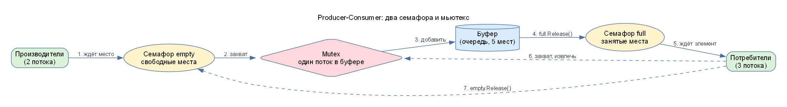
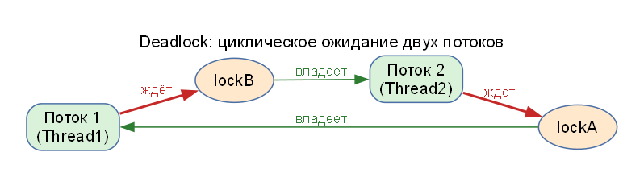
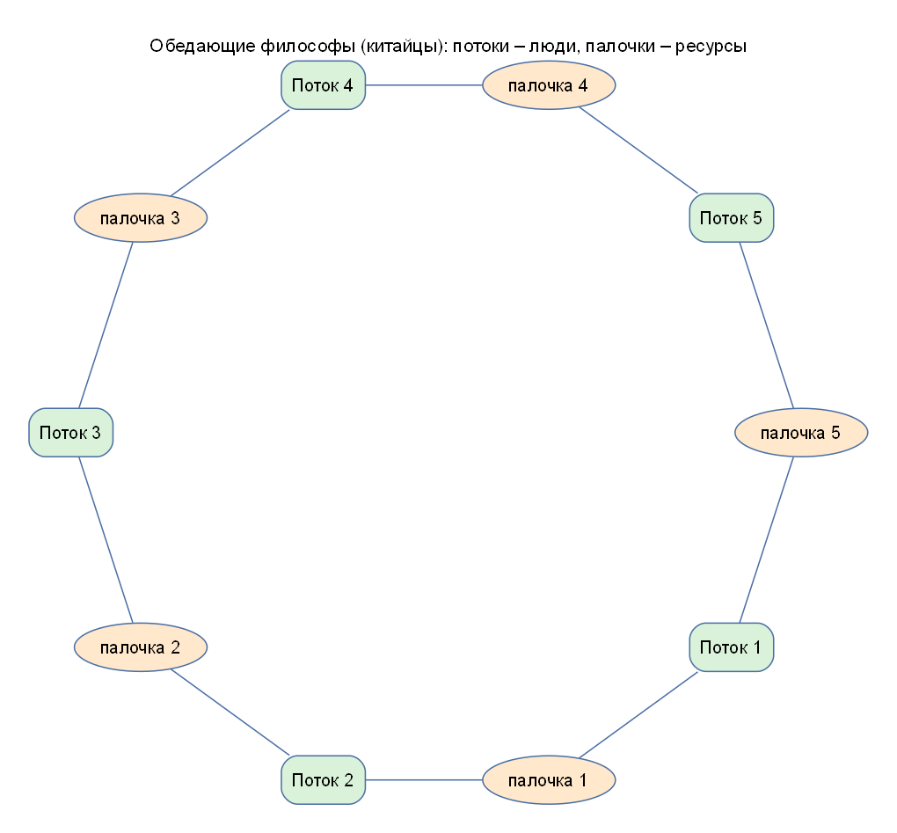

# ССП-5. Теория подробно

Если вы видите эту тему впервые, читайте по порядку: каждый раздел опирается на предыдущий.

## 1. Процесс, поток, задача

**Процесс** – запущенная программа: у неё своя область памяти. **Поток (thread)** – «рабочий» внутри процесса: у каждого потока свой **стек** (локальные переменные), но **куча** (объекты) у всех потоков процесса общая. Поэтому два потока могут одновременно менять один и тот же объект – отсюда все проблемы этой лабораторной.

**Задача (`Task`)** – объект .NET, описывающий кусок работы. Пул потоков сам выбирает, на каком потоке её выполнить. `Task.Run(() => ...)` ставит работу в очередь пула.

## 2. Гонка и критическая секция

**Критическая секция** – участок кода, в котором поток работает с общими данными и который нельзя выполнять одновременно двумя потоками.

Пример: `counter++` – это три шага (прочитать, прибавить, записать). Если два потока выполнят их одновременно, одно приращение потеряется. Такая ситуация называется **гонкой данных (race condition)**.

Чтобы в критической секции был только один поток, используют **взаимное исключение**: `lock`, `Monitor`, `Mutex`.

## 3. lock, Monitor, Mutex, Semaphore

| Примитив | Сколько потоков пускает | Между процессами | Знает владельца | Особенность |
|---|---|---|---|---|
| `lock (obj)` | 1 | нет | да | самый быстрый, освобождается сам при выходе из блока |
| `Monitor.TryEnter(obj, timeout)` | 1 | нет | да | можно не ждать вечно – вернёт `false` |
| `Mutex` | 1 | **да** (именованный) | да | медленнее, нужно `ReleaseMutex()` |
| `SemaphoreSlim(n)` | до n | нет | нет | счётчик «разрешений», освободить может любой поток |

Метафора: **мьютекс** – ключ от одной комнаты: вошёл один, остальные ждут у двери. **Семафор** на 3 – гардероб с тремя крючками: пока есть свободный крючок, заходят; крючки кончились – ждут.

## 4. Producer-Consumer (производитель – потребитель)

- **Производитель** создаёт данные и кладёт в буфер.
- **Потребитель** достаёт из буфера и обрабатывает.
- **Буфер** ограничен (5 мест), поэтому нужны **два семафора**:
  - `empty` – сколько мест свободно (изначально 5). Производитель перед добавлением ждёт `empty`, если мест нет – блокируется.
  - `full` – сколько элементов лежит (изначально 0). Потребитель перед извлечением ждёт `full`, если буфер пуст – блокируется.
- **Мьютекс** защищает саму очередь: `Queue<T>` не потокобезопасна.

Порядок действий производителя: `empty.Wait` → `mutex.WaitOne` → добавить → `mutex.ReleaseMutex` → `full.Release`. Потребителя: `full.Wait` → `mutex.WaitOne` → извлечь → `mutex.ReleaseMutex` → `empty.Release`.

**Почему размер буфера не влияет на результат в нашем запуске:** производители создают элемент каждые 200–600 мс, потребители обрабатывают за 300–800 мс, но потребителей трое, поэтому они «съедают» элементы быстрее, чем те появляются, и буфер почти пуст. Размер важен, только если производители быстрее потребителей.

## 5. Deadlock (взаимоблокировка, тупик)

Условия deadlock (должны выполняться **все** четыре):
1. **Взаимное исключение** – ресурс может держать только один поток.
2. **Удержание и ожидание** – поток держит один ресурс и ждёт другой.
3. **Отсутствие принудительного изъятия** – ресурс нельзя отнять, только добровольно отдать.
4. **Циклическое ожидание** – поток 1 ждёт ресурс потока 2, а поток 2 – ресурс потока 1.

Наша программа: `Thread1` берёт `lockA`, ждёт `lockB`; `Thread2` берёт `lockB`, ждёт `lockA`. Через секунду оба заснули навсегда.

**Как лечить:**
- **Одинаковый порядок захвата** (оба берут сначала A, потом B) – ломает условие 4. Это самый надёжный способ.
- **Тайм-аут** (`Monitor.TryEnter(obj, TimeSpan)`) – если не получилось за N секунд, поток сообщает об ошибке (ломает условие 2/3 – поток отказывается ждать).
- Держать как можно меньше блокировок одновременно.

**Голодание (starvation)** – поток не получает ресурс потому, что его постоянно опережают другие; остальная программа при этом работает. При deadlock потоки блокируют друг друга и не работают вообще.

## 6. Задача об обедающих философах (китайцы и палочки)

Это «задача», о которой говорили в чате группы.

За круглым столом сидят 5 китайцев, между соседями лежит по палочке (всего 5). Чтобы поесть, нужны **две** палочки – слева и справа. **Китайцы – это потоки, палочки – ресурсы (блокировки).** **Рис – не ресурс**: он просто «работа», которую нужно выполнить, чужим потокам он не мешает.

Если все одновременно берут левую палочку, то все ждут правую, которую держит сосед – получился **deadlock**.

Как решают (из подсказки чата: «сначала нужно отпустить одни потоки, а потом уже другие»):
- **Нумерация ресурсов:** палочки пронумерованы, каждый берёт сначала палочку с **меньшим** номером, потом с большим. Цикла ожидания уже не будет (то же, что «одинаковый порядок захвата»).
- **Ограничить число одновременно «обедающих»** до 4 (семафор на 4): тогда хотя бы один всегда получит обе палочки, **освободит** их, и дальше смогут есть остальные.
- **Тайм-аут:** не получил вторую палочку за время – положил первую и повторил попытку.

Соответствие с лабораторной: `lockA`, `lockB` – палочки; `Thread1`, `Thread2` – китайцы; исправление «оба берут сначала lockA» – нумерация палочек.

## 7. Именованный Mutex и один экземпляр программы

Обычный `lock` виден только внутри одного процесса. `new Mutex(false, "Global\\MyAppMutex")` создаёт мьютекс **с именем в операционной системе**, поэтому второй запущенный процесс видит тот же мьютекс. Если первый его удерживает, второй за 3 секунды не захватит его и сообщит об этом. Так делают «разрешить запуск только одной копии программы».

## 8. TPL: параллельные циклы

`Parallel.For(0, N, i => ...)` разбивает итерации на части и выполняет их на нескольких потоках. Подходит, когда итерации **независимы** друг от друга.

**Главное правило:** не обращайтесь к одной общей переменной на каждой итерации. Версия с `lock` на каждой итерации оказалась в 11 раз медленнее последовательного цикла: поток тратит время не на вычисление, а на ожидание блокировки. Правильно – **локальные переменные потока**: каждый поток накапливает сумму у себя, а общий `lock`/`Interlocked.Add` выполняется один раз в конце потока (параметры `localInit`, `body`, `localFinally`).

`ParallelLoopState.Break()` прекращает выдачу новых итераций; `CancellationToken` позволяет отменить цикл снаружи (при отмене выбрасывается `OperationCanceledException`).

## 9. PLINQ

`data.AsParallel().Where(...).Select(...)` – тот же LINQ, но выполняется на нескольких ядрах. `AsOrdered()` сохраняет порядок исходной коллекции (немного медленнее), `WithDegreeOfParallelism(n)` ограничивает число потоков. **PLINQ не всегда быстрее:** на дешёвых операциях накладные расходы на разбиение данных и сборку результата больше выигрыша.

## 10. Разделение данных и агрегация

| Стратегия | Описание | Применение |
|---|---|---|
| диапазоны | непрерывные куски | массивы, списки |
| блоки (`Partitioner.Create(0, N, размер)`) | небольшие блоки, раздаются по мере освобождения потоков | динамическая балансировка |
| хеш | по хешу ключа | операции по ключу |

**Агрегация** – объединение частичных результатов потоков в один: через `Interlocked.Add`, `lock`, либо встроенные `Sum`/`Average`/`Aggregate` в PLINQ.

## 11. Закон Амдала в двух словах

Ускорение ограничено долей кода, которую нельзя распараллелить, и накладными расходами на потоки. Поэтому ускорение редко равно числу ядер, а на лёгких задачах параллельная версия может быть даже медленнее (это видно в задании 3).
